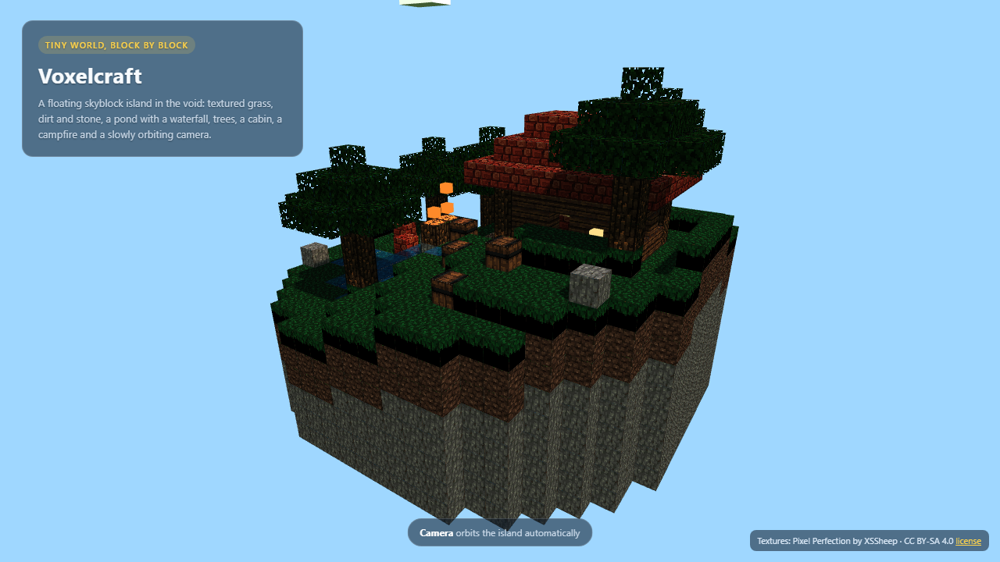

# Frontier benchmark: Minecraft-style voxel world

This folder contains a reproducible **frontier-model benchmark** used to compare
local LM Studio models against hosted frontier models on the same task. Only the
frontier/agent artifacts and results are committed here; local model results are
kept outside git (they are machine-specific).

## Task

The model must produce **one self-contained HTML file** (`index.html`) that
renders a Minecraft-style floating voxel island with Three.js from a CDN. No
build step, no bundler, no external assets (images, sounds or zip files).

### Exact prompt

```text
Create one single HTML file named index.html — a Minecraft-style voxel world
rendered with Three.js loaded from a CDN. No build step, no bundler, no server,
no external assets (no images, sounds or zip files); everything except
Three.js must be inside this one file.

The page must contain:
- A hero section that feels like a tiny Minecraft world.
- Procedural terrain made of colored cubes (grass green, dirt brown,
  stone gray, water blue).
- Smooth 60fps rendering with requestAnimationFrame.
- A camera that automatically orbits the floating island (no player
  controls are required).
- Animated sky / day-night feel (moving sun or color gradient).
- Clean, modern, commented code.

Output ONLY the complete HTML in a markdown code fence starting with
```html and ending with ```. Do not include any other text.
```

The committed frontier artifact uses the **visual** interpretation requested
for the example: a floating skyblock island in the void with textured grass,
dirt and stone, a pond and a waterfall, five trees, a cabin with a furnace,
crafting table, bed and porch lantern, a campfire, flowers and rocks, with the
camera orbiting automatically. It is intentionally not a playable game.

### Textures and license

The committed example uses **Pixel Perfection** by Hugh "XSSheep" Rutland,
licensed **CC BY-SA 4.0**. Only 19 basic block textures are included; they are
packed into a 5x4 atlas and embedded as a base64 data URI so the artifact stays
a single file. Attribution and the full license are in
[`deepseek_agent/minecraft_world/textures/pixel_perfection/`](deepseek_agent/minecraft_world/textures/pixel_perfection/):

- [NOTICE.md](deepseek_agent/minecraft_world/textures/pixel_perfection/NOTICE.md)
- [LICENSE-CC-BY-SA-4.0.txt](deepseek_agent/minecraft_world/textures/pixel_perfection/LICENSE-CC-BY-SA-4.0.txt)
- [ATLAS.md](deepseek_agent/minecraft_world/textures/pixel_perfection/ATLAS.md)

The texture work is CC BY-SA 4.0; the surrounding code stays under the
repository's MIT license. The original Minecraft textures are **not** used.

A procedural atlas (`deepseek_agent/minecraft_world/texture_atlas.js`) remains
available as an asset-free alternative for models that should generate their
own textures.

## Acceptance criteria (same harness for every model)

| Check | What it verifies | Weight | Critical |
|---|---|---:|---|
| `index_html_exists` | `index.html` exists | 1.0 | yes |
| `html_not_empty` | at least 50 characters of HTML | 1.0 | yes |
| `single_file_html` | starts with `<!DOCTYPE html>` or `<html` | 1.0 | yes |
| `has_threejs` | a real `<script src=...three...js>` | 1.0 | — |
| `has_voxel_cubes` | `BoxGeometry(` or `InstancedMesh(` | 1.5 | — |
| `has_grass` | `grassTop` / `grass:` / `#4caf50` | 1.0 | — |
| `has_stone` | `stone:` / `#8b939b` / `#808080` | 1.0 | — |
| `has_water` | `water:` / `waterMat` / `#2f7fd4` | 1.0 | — |
| `has_camera` | `PerspectiveCamera` / `.lookAt(` | 1.5 | — |
| `has_render_loop` | `requestAnimationFrame(` / `function animate(` | 1.5 | — |
| `no_external_assets` | no `.png/.jpg/.jpeg/.gif/.zip` references | 1.0 | — |

The score is the weighted share of passing checks, **except that a critical
failure vetoes the attempt to `0.0`**. The regex checks target real code
constructs, not prose mentions. The static web validator also verifies that the
HTML parses, has a title/lang/viewport, one `h1`, inline JS syntax, labelled
inputs and no external scripts/styles.

## Frontier result (DeepSeek V4.1 Flash agent)

| Task | Score | Pass | Artifact |
|---|---:|---|---|
| `minecraft_world` | **1.0** | yes | [index.html](deepseek_agent/minecraft_world/index.html) |
| `web_dashboard` | **1.0** | yes | [index.html](deepseek_agent/web_dashboard/index.html) |
| `email_write` | **1.0** | yes | [email.txt](deepseek_agent/email_write/email.txt) |
| `blender_skyblock` | **1.0** | yes | [build_scene.py](deepseek_agent/blender_skyblock/build_scene.py) |

Full table: [frontier_comparison.md](frontier_comparison.md) and
[frontier_comparison.csv](frontier_comparison.csv).

The Blender artifact was rendered headless with Blender 5.2: `scene.blend`
(2.53 MB, uncompressed) plus 120 PNG frames at 640x360. The first frame is
[blender_skyblock_deepseek_frame_0001.png](blender_skyblock_deepseek_frame_0001.png).

The Minecraft page was verified in a real browser: Three.js loaded, the canvas
rendered 21 draw calls / 35,844 triangles, the centre pixel was grass green, and
the console had no errors.



The preview above is a headless Chromium screenshot of the committed
`minecraft_world/index.html` (1280x720), not an illustration.

## Reproduce

Score the committed artifacts with the same harness:

```powershell
python tools/agent_benchmark.py --tasks minecraft_world,web_dashboard,email_write,blender_skyblock
```

Run the same task against a local model:

```powershell
python -m lm_optimizer.cli.main lab sandbox --task minecraft_world --model <model-id>
```

Customise the scene while keeping the same skyblock base:

```powershell
python -m lm_optimizer.cli.main lab sandbox --task minecraft_world ^
  --model <model-id> --scene "fewer trees, a lighthouse and a bigger pond"
```

`--custom-prompt "..."` replaces the whole prompt when you need full control.
Keep the base grass/dirt/stone island and (optionally) water in the brief if you
want all static checks to pass.

Regenerate the frontier-only report:

```powershell
python tools/bakeoff_report.py --frontier-only --out-dir docs/benchmarks
```

## Notes

- The Minecraft scene loads Three.js r128 from jsDelivr, so the page needs
  network access for the library; everything else is inside the file.
- Local model scores (LM Studio, RTX 3060 6 GB) are intentionally **not**
  committed. They remain in `results/` and in the desktop comparison files.
