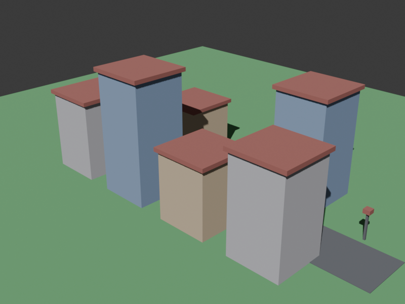

# Blender city benchmark

Task id: `blender_city`.

This is a **static** Blender benchmark: the model must build a simple low-poly
city, save `scene.blend`, and render **one** preview image. No animation frames.

## Prompt (copy into the model under test)

```text
Write a Blender Python script that builds a simple low-poly city: 4-8 cubic
buildings of varied heights on a ground plane, a road, a sun light and a camera
looking at the city. Save the scene first as scene.blend, then render exactly
ONE preview image named preview.png (PNG, at least 640x480) using
bpy.ops.render.render(write_still=True). Do NOT render an animation and do not
create a frames/ directory. Output ONLY the complete Python script in a markdown
code fence starting with ```python and ending with ```.
```

## Acceptance checks

| Check | What it verifies | Weight | Critical |
|---|---|---:|---|
| `script_defines_scene` | uses `bpy.ops.mesh` / primitive cubes | 2.0 | yes |
| `has_buildings` | buildings / cubes | 1.5 | — |
| `has_ground` | ground / road / plane | 1.0 | — |
| `has_camera` | camera | 1.0 | — |
| `has_light` | sun / light | 1.0 | — |
| `saves_blend` | `save_as_mainfile` | 1.0 | yes |
| `renders_still` | `write_still=True` | 1.5 | — |
| `no_animation` (negated) | no animation render | 1.0 | — |
| `blend_runs` | Blender exited 0 | 1.0 | yes |
| `blend_is_binary` | real `.blend` (zstd/gzip accepted) | 2.0 | yes |
| `blend_min_size` | `.blend` > 100 KB | 1.0 | yes |
| `preview_rendered` | `preview.png` exists and > 1 KB | 1.5 | yes |

## Run

```powershell
python -m lm_optimizer.cli.main lab bakeoff --models <model-id> --tasks blender_city --context 8192 --safe
```

Artifacts: `results/bakeoff/<model>/blender_city/<timestamp>/build_scene.py`,
`scene.blend`, `preview.png`, `debug.json`. The produced `.blend` is also copied
to `results/blends/<model>/blender_city/<timestamp>.blend` (also for
`blender_skyblock`), so you can open it in Blender even after the scratch
workdir is cleaned; the path is recorded as `blend_file` in the run result and
shown in the web UI history.

## Reference result

The committed DeepSeek V4.1 Flash artifact
(`benchmarks/deepseek_agent/blender_city/build_scene.py`) scores **1.0** with
Blender 5.3. Open `scene.blend` in Blender to inspect the city; `preview.png` is
the single rendered still.



## Skyblock stays separate

`blender_skyblock` remains its own benchmark (animated orbit, 120 frames). This
task deliberately tests only a static, openable scene and one preview.
